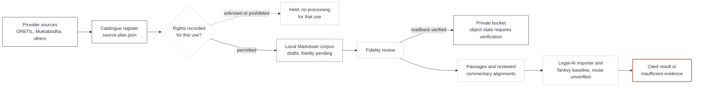
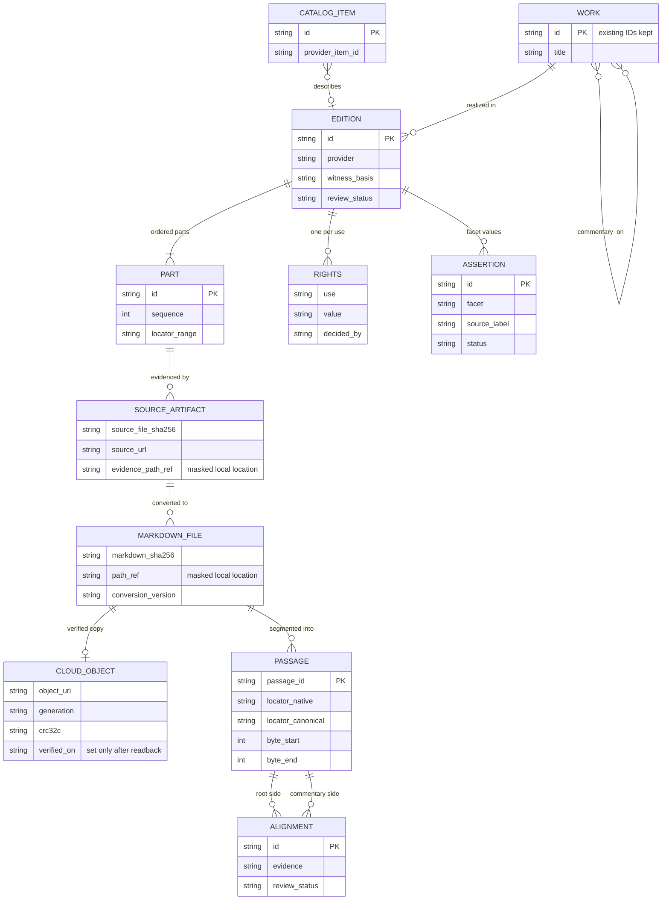
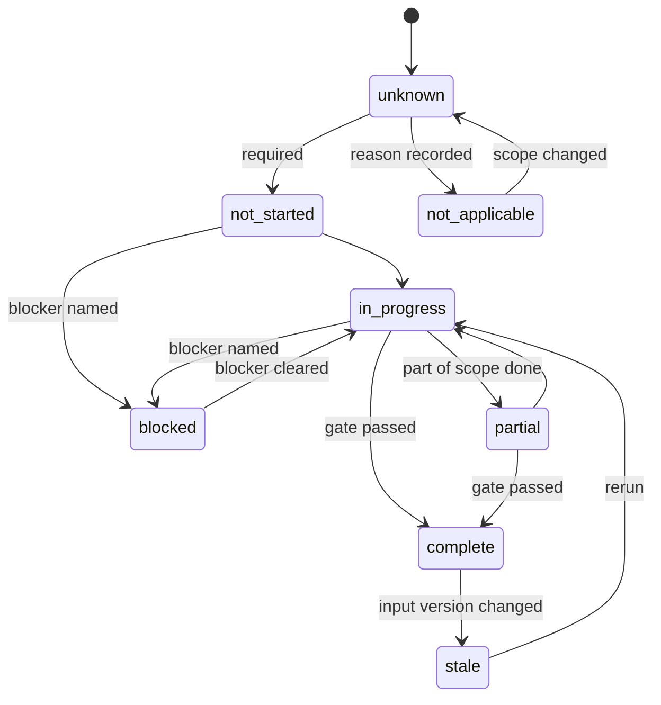
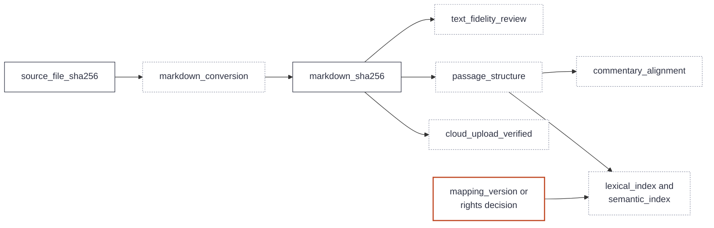
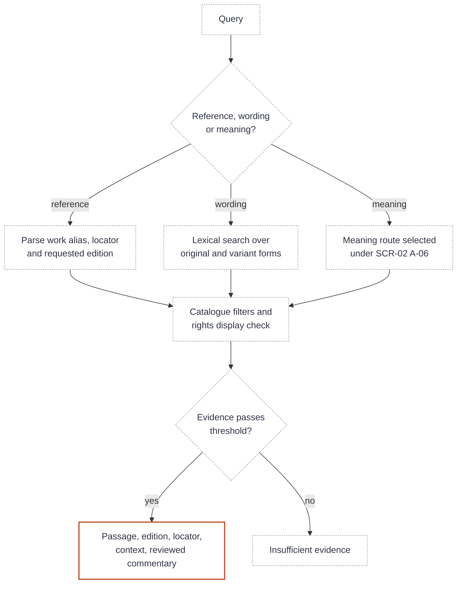

# Scripture catalogue, ingestion and retrieval design

| Item | Value |
|---|---|
| Status | Proposed design. Nothing in this document is implemented unless section 2 marks it as actual. |
| Date | 2026-11-26, revised 2026-11-27 against `main` at `7f044a9` |
| Owner | Pending confirmation |
| Stories | [SCR-01 catalogue](../story.md) and [SCR-02 passage search](../scripture-search/story.md) |
| Proposed location | `docs/scripture-catalog-ingestion-and-rag-design.md` on `main` |

Both stories, their checklists and scenarios, the catalogue register, the inventory review, the MVP plan and two draft catalogue scripts are on `main`. Local working evidence (batch reports, manifests and Markdown drafts) is not in the repository.

Commands, schemas, file names and field names marked **illustrative** are proposals. They do not describe tools that already exist.

Every statement carries one of four labels. **Actual** means evidenced by a committed file, a recorded result or a verified resource. **Draft** means it exists locally or as an unreviewed candidate. **Proposed** means designed but not built. **Candidate** means an option that needs scripture specific evidence before it is selected. Scenario IDs are story specific: SCR-01 A-01 and A-02 are not SCR-02 A-01 and A-02.

## 1. Purpose and scope

The goal is a private, source grounded search and retrieval system for Hindu, Sanatana and Buddhist scriptures, commentaries, translations and collected teachings. A scripture researcher can find a passage by citation, wording or meaning and see the original wording, the edition, an exact locator, the surrounding context and any attributed commentary whose alignment has been reviewed. The system reports insufficient evidence instead of guessing.

The first pilot is the Vijñāna Bhairava with its available editions and commentary, together with the Muktabodha batch. The broad corpus follows only after the pilot passes its gates (section 13). The wider catalogue covers paths to the Vedas, Upaniṣads, Tantras, Āgamas, other Hindu and Buddhist sources and the works of twenty proposed spiritual masters. Coverage is tracked against named reference lists. This document makes no completeness claim for any source, list or tradition.

Three layers stay separate:

* **Catalogue.** `source-plan.json` and its successors are an inventory and a filter aid. They are not the retrieval corpus.
* **Corpus.** `UTF-8` Markdown only, in the local corpus folder and in the private bucket.
* **Evidence and manifests.** Original source files, provenance sidecars, conversion reports and reconciliation reports. These live outside the corpus folder and outside the bucket.

### 1.1 End to end flow



Rights are checked per use before any processing, so a held item never reaches conversion, upload or indexing. Fidelity review sits before both the bucket and passage building, so neither copies an unreviewed text.

### 1.2 Diagram conventions

Diagrams are Mermaid source in this file, so GitHub renders them and pull requests diff them as text. They follow the editorial rules of [diagram-design](https://github.com/cathrynlavery/diagram-design): one idea per node, about nine nodes per diagram, one accent on the outcome, no shadows. That project writes self contained HTML with inline SVG, exportable to SVG or PNG. GitHub shows such output only as an image or a link, while Mermaid source remains directly diffable in this document. Any accompanying HTML or SVG needs its own source and visual review. Borders: solid means actual, long dash draft, short dash proposed or candidate, accent the outcome.

## 2. Actual versus planned

| Area | Actual now | Planned in this design |
|---|---|---|
| Catalogue | `source-plan.json` with `schema_version` 2.0: 1,743 `catalog_items`, 171 `work_targets`, 5 `works`, 6 `editions`, 1 `relations` row, 5 `local_markdown_assets`, 20 `master_candidates`, and `$jsonviews` with ten views. | Schema 3.0 as an additive migration (section 7). |
| Muktabodha batch | The local report records 560 draft Markdown files from 569 input records. Nine exceptions: missing source header IDs for M00241, M00242 and M00672, and conflicting header IDs for M00308, M00401, M00403, M00404, M00405 and M00517. Rights and source fidelity review is pending. | Exceptions resolved against the publisher catalogue and archive. Rights and fidelity gates (section 13). |
| Catalogue migration | Draft: `scripts/migrate-v3.py` writes a schema 3.0 candidate to a new file and never edits the source. Its two unit tests pass. A review dry run on 2026-11-27 against `source-plan.json` at `7f044a9` produced 2,776 proposed assertions with status `candidate_review_pending` and lost no 2.0 value outside the regenerated coverage counts. No candidate is committed, and `source-plan.json` remains 2.0. | Review, then complete the proposed steps (section 8). |
| Local corpus pointers | Draft: `scripts/attach-local-candidates.py` adds pointers with verified Markdown hashes to a new candidate file, with `cloud_uri` null and status `draft_fidelity_and_rights_pending`. No output is committed. | Stage records (section 9.5). |
| Review tracking | Draft: the local review catalogue has per-item stage records and definitions; these have not been independently verified or published. | Validate and migrate stage records; automatic invalidation is proposed (section 9.5). |
| Passage search | Not implemented. Passage segmentation, alignment, indexing and the query flow are proposed. Retrieval components beyond the Legal-AI baseline are candidates. | Sections 12.3 and 12.4. |
| Local storage | Markdown drafts are in `scripture-ingestion/pilot/corpus/muktabodha`. Sidecar manifests are outside that folder. The report and manifests are local working evidence with no shared restricted access recorded. | Masked path references and a committed manifest index (section 5). |
| Cloud Storage | The private bucket `gs://aispanda-scripture-corpus-2026` exists in project `aispanda`, location `us-east1`, Standard storage class, with uniform bucket level access and public access prevention. Upload status is unverified, and no object readback has been recorded. | Preflight, upload, readback and reconciliation (section 11). |
| Legal-AI | A documented hybrid design: a Tantivy route for keyword and exact citation search, and a Qdrant route described as semantic plus BM25. A JSONL import contract with required `document_id`, `title`, `text` and `locator`. | A scripture export through that contract (section 12). |
| Model trials | A six file Jev test on the first 4,000 characters found useful genre signals, but also conflicts between genre and tradition, weak identification of author and publisher roles, and no independently reviewed gold labels. | Model use only for triage, behind a rights gate and an evaluation gate (sections 10 and 13). |
| Acceptance | SCR-01 A-01 and A-02 and SCR-02 A-01 to A-06 are NOT RUN. | Gates map to story scenarios and tasks in section 13.4. |

## 3. Decisions

Each decision considered the Grok and Gemini reviews and the catalogue itself. Section 17 lists every claim from those reviews that was corrected.

1. **Deterministic metadata first, and human review for the pilot.** The pilot slice is small, so deterministic parsing plus review is cheaper than tuning a model on it, and it builds the gold labels the project lacks.
2. **Models suggest and people verify.** No model output ever sets `review_status` to `verified`. Rights, edition identity, work identity, agent roles and `commentary_on` links are never accepted from a model, whatever its confidence.
3. **Rights gate before any external processing.** Each item has a use specific rights record. An `unknown` value blocks hosted model calls, hosted embeddings and redistribution. Local processing remains possible where storage and private use are permitted.
4. **Jev is a candidate for triage, not for extraction.** Jev returns typed answers with probabilities. It does not return evidence spans, so evidence comes from deterministic rules or from a generative model with document citations, checked against the source bytes.
5. **Every facet value is an assertion with evidence.** Normalized display fields are generated from those assertions, so the existing JSON Views keep working.
6. **Stable identifiers are never reissued.** IDs that already exist are kept exactly. New IDs are minted once and never derived from mutable titles.
7. **Exact pointers name bytes, not just text.** A citation pins the edition, the Markdown checksum, the object generation and byte offsets, plus a human readable locator.
8. **Cloud Storage metadata is operational only.** Search and filter facets live in the catalogue and in the retrieval index, never only in object metadata.
9. **Legal-AI is reused without changing its contract at first.** Scripture facets travel in a parallel file keyed by chunk ID until the importer is shown to accept extension fields.
10. **Every stage has its own status.** Each subject records a separate status for each stage in section 9.5, and no stage is inferred from another.
11. **Parts are assembled only within one edition.** Multivolume assembly needs evidence of edition compatibility and keeps every part and gap (section 7.6).
12. **The Legal-AI baseline is the foundation, and everything beyond it is a candidate.** Script normalization, sandhi and lemma processing, embeddings, hybrid fusion, reranking and a knowledge graph are selected only on scripture specific evidence (section 12.4).

## 4. Invariants

* Source data is never overwritten. Provider labels are kept exactly as the provider gives them, next to the normalized values.
* Unknown is not none. An empty value means not yet established, and filters must show it as unknown.
* Genre, tradition, sampradāya, school (śākhā) and darśana are separate dimensions.
* Language, script and transliteration scheme are separate fields.
* Work, edition, witness file and corpus object are separate entities.
* Source wording and attribution are displayed and indexed unchanged. Normalized or segmented forms are separate derived fields.
* Distinct editions are never merged, even when their volumes cover adjacent ranges.
* The corpus folder and the bucket hold Markdown only. Manifests, catalogue files, original sources and reports live elsewhere.
* No absolute local paths, user names or drive letters appear in any committed file or object metadata.

## 5. Local storage and masked paths


### 5.1 Layout

Only `corpus/muktabodha` is actual. The other folders are illustrative, and the actual location of the sidecar manifests must be confirmed and recorded.

```text
${SPIRITUALITY_WORKSPACE}/
  scripture-ingestion/
    pilot/
      corpus/
        muktabodha/          # actual: Markdown drafts only
      manifests/
        muktabodha/          # sidecar provenance per item (location to confirm)
      evidence/
        muktabodha/          # original downloaded files, never indexed
      reports/
        conversion/          # batch reports, exception lists
        reconciliation/      # local vs manifest vs bucket
```

### 5.2 Path references

Every committed path is a pair: a root alias and a relative POSIX path.

```json
{
  "path_ref": {
    "root": "SPIRITUALITY_WORKSPACE",
    "rel": "scripture-ingestion/pilot/corpus/muktabodha/muktabodha-m00271.md"
  }
}
```


The mapping from alias to a real location lives in an untracked local file, for example `storage-roots.local.json` (illustrative), which is listed in `.gitignore`:

```json
{ "SPIRITUALITY_WORKSPACE": "<absolute path on this machine, never committed>" }
```

The rules are:

1. Use forward slashes and Unicode NFC file names.
2. Name new corpus files from stable IDs in lowercase ASCII, for example `muktabodha-m00271.md`. Descriptive titles belong in front matter and the catalogue, not in file names.
3. Keep the existing `local_markdown_assets[].markdown_path` values exactly. They already follow the convention that paths are relative to the Spirituality workspace. Add a `path_ref` beside each one instead of rewriting it.
4. Run a check (illustrative) that rejects any committed JSON containing a drive letter, a home folder pattern or a leading slash outside URLs.

## 6. Identifiers, versions, checksums and pointers

### 6.1 Identifiers

| Entity | Existing examples | Rule for new IDs |
|---|---|---|
| Catalogue item | `gretil-0af7c8595faf37d305d2`, `muktabodha-m00271` | Keep existing IDs exactly. New rows use `provider` plus the provider item ID when one exists. |
| Work | `pilot-vijnana-bhairava` | `work-<ascii slug>`, with a numeric suffix on collision. Never renamed. A merge uses `superseded_by`. |
| Edition | `gretil-faliero`, `muktabodha-m00271` | Keep existing IDs. New ones use `<provider>-<item id or edition slug>`. |
| Markdown asset | `vijnana-bhairava-bhu-c4245-m00271` | Keep existing IDs. New corpus files use the edition ID. |
| Corpus object | none yet | `obj-<edition_id>-<first 12 hex of markdown sha256>` |
| Passage | none yet | `<edition_id>:<scheme><native locator>`, for example `muktabodha-m00271:seq0024` |
| Agent | none yet | `agent-<ascii slug>`, for example `agent-anandabhatta` |
| Assertion | Draft: `fa-` plus the first 20 hex of sha256 over `root:item id:field:position`, from `scripts/migrate-v3.py` | Keep for migrated assertions. Later assertions hash subject, facet, method and evidence pointer (proposed). Readable IDs in section 7.3 are illustrative. |
| Relation | `rel-vijnanakaumudi-vijnanabhairava` | Keep. New ones use `rel-<subject>-<predicate>-<object>`. |
| Stage record | none yet | `st-<subject id>-<stage key>`, one per subject and stage (proposed) |

The string `muktabodha-m00271` is used both as a catalogue item ID and as an edition ID. That is acceptable only if every reference names its type, as in `{"type": "edition", "id": "muktabodha-m00271"}`. Schema 3.0 requires typed references for new fields.

### 6.2 Versions


* `schema_version` is the catalogue schema version: currently 2.0, proposed 3.0.
* `catalog_release` is a dated tag plus the git commit of the catalogue file, for example `2026-12-01+<commit>`.
* `conversion_version` is the converter name, version and settings hash used to produce each Markdown file.
* `mapping_version` is the version of each label mapping table.
* `model_run` records the provider, the exact model ID, the prompt or question template version and the date, for every model assertion.

### 6.3 Checksums

* `source_file_sha256` is the hash of the original file bytes, as downloaded.
* `markdown_sha256` is the hash of the exact Markdown bytes as stored. No normalization is applied before hashing. Any normalization happens before the file is written.
* `gcs_crc32c` and `gcs_md5` are the values Cloud Storage reports on readback. MD5 is not available for composite objects, so CRC32C is the required check.
* `gcs_generation` and `gcs_metageneration` come from readback. A content change creates a new generation. A metadata change raises the metageneration only.

### 6.4 Exact pointer

```json
{
  "passage_id": "muktabodha-m00271:seq0024",
  "edition": {"type": "edition", "id": "muktabodha-m00271"},
  "work": {"type": "work", "id": "pilot-vijnana-bhairava"},
  "markdown_sha256": "361bfe7f16dfa93350ab9af11c521ced6dbfb6ebbb928efacf6309b411f072c5",
  "object_uri": "gs://aispanda-scripture-corpus-2026/corpus/muktabodha/muktabodha-m00271.md",
  "gcs_generation": "<from readback>",
  "byte_start": 10234,
  "byte_end": 10391,
  "locator_native": {"scheme": "sequence", "value": "24"},
  "locator_canonical": {"scheme": "verse", "value": null, "status": "pending_review"},
  "source_url": "https://muktabodha-digital-library.org/texts/IAST/M00271"
}
```


The byte offsets and hash shown are an example of the shape, and the offsets are illustrative. The native and canonical locators are separate because the catalogue records that the BHU C4245 witness has irregular numbering that restarts. A canonical verse number is attached only after review.

## 7. Catalogue schema 3.0

### 7.1 Entities

* **work**: an abstract text, such as the Vijñāna Bhairava or the Vijñānakaumudī.
* **edition**: a specific published or digital text of a work, from one provider and witness basis.
* **catalog_item**: a provider inventory row. It is kept as source data.
* **agent**: a person or body. Roles are given through `agent_roles` on works and editions.
* **relation**: `commentary_on`, `translation_of`, `parallel_of`, `part_of` or `same_work_as`, each with evidence and a review status.
* **facet_assertion**: one value for one facet on one subject, with its evidence.
* **rights_assessment**: a use specific rights decision for one edition or collection.
* **corpus_object**: one Markdown file as stored locally and in Cloud Storage.
* **vocabulary**: controlled values with the provider labels mapped to them.

Passages and alignments live in per edition manifests outside the catalogue, because there will be far more of them than catalogue rows.

### 7.2 Facets

| Facet | Values | Subject | First source | Never inferred from title or opening |
|---|---|---|---|---|
| provider, source collection | one | item, edition | catalogue | no |
| language | many | edition | provider metadata, TEI header | no |
| script (ISO 15924, such as Latn, Deva) | many | edition | provider metadata | no |
| transliteration scheme (IAST, ITRANS, Harvard Kyoto, Velthuis) | one per text layer | edition | provider metadata, file inspection | no |
| content role (root, commentary, root with commentary, translation, modern teaching) | many | edition | provider metadata, header | **yes** |
| genre | many | work | provider labels, section path | no, but needs review |
| traditions | many | work, edition | provider labels | needs evidence |
| sampradāya | many | work, edition, agent | explicit header, colophon or reference work | **yes** |
| school or śākhā | many | work, edition | reference list, header | **yes** |
| darśana | many | work | reference list, header | **yes** |
| topics | many | work, passage | reviewed tagging | discovery only |
| agents with roles (author, commentator, subcommentator, editor, translator, encoder) | many | work, edition | provider fields, header, colophon | **yes** |
| publisher, digital publisher | many | edition | provider fields, title page | **yes** |
| publication year, extent | one | edition | provider fields | **yes** |
| rights by use | one per use | edition, collection | licence text | **yes** |
| canonical reference (such as Muktikā list position, SuttaCentral UID) | many | work | reference lists | **yes** |
| related master | many | edition, work | master bibliography | **yes** |
| review status | one | every record | process | not applicable |

Buddhist coverage uses the same facets. A SuttaCentral UID such as `mn1` is a canonical reference. Tradition values follow the existing view options (Theravada, Mahayana and Vajrayana under Buddhist). In the current catalogue, Buddhist material is mostly the 238 GRETIL rows under the Sanskrit Buddhist section, plus one SuttaCentral Pāli row. That is an inventory fact, not a statement of coverage.

The 20 master candidates all have the selection status `proposed`. Each master's works are inventoried from the publisher bibliography that the catalogue already links. Modern collected teachings are likely to be under copyright, so their rights assessments default to `unknown`.

### 7.3 Example records (illustrative)

The values below are copied from the current catalogue where they exist.

```json
{
  "agents": [
    {
      "id": "agent-anandabhatta",
      "names": [{"value": "Ānandabhaṭṭa", "script": "Latn", "scheme": "IAST", "source": "muktabodha-m00347"}],
      "review_status": "pending"
    }
  ],
  "works": [
    {
      "id": "pilot-vijnanakaumudi",
      "title": "Vijñānakaumudī on Vijñāna Bhairava",
      "kind": "commentary",
      "agent_roles": [

        {"agent": "agent-anandabhatta", "role": "commentator",
         "assertion": "fa-muktabodha-m00347-agents-001"}
      ],
      "traditions": ["Shaiva"],
      "review_status": "pending"
    }
  ],
  "facet_assertions": [
    {
      "id": "fa-muktabodha-m00347-traditions-001",
      "subject": {"type": "catalog_item", "id": "muktabodha-m00347"},
      "facet": "traditions",
      "source_label": "Non-dual Śaivism of Kashmir",
      "normalized_value": null,
      "mapping_version": null,
      "method": "provider_metadata",
      "evidence": {
        "kind": "provider_catalogue",
        "url": "https://muktabodha-digital-library.org/texts/IAST/M00347",
        "snapshot": "muktabodha_metadata_2026-08-24.csv"
      },
      "status": "proposed",
      "asserted_by": "catalogue_migration_v3",
      "asserted_on": "2026-11-26"
    },
    {
      "id": "fa-muktabodha-m00347-agents-001",
      "subject": {"type": "catalog_item", "id": "muktabodha-m00347"},
      "facet": "agents",
      "source_label": "<Unknown>, Ānandabhaṭṭa",
      "normalized_value": [
        {"agent": null, "role": "author_of_root", "status": "unknown"},

        {"agent": "agent-anandabhatta", "role": "commentator", "status": "proposed"}
      ],
      "method": "provider_metadata_split",
      "evidence": {"kind": "provider_fields", "fields": ["author", "commentator"]},
      "status": "proposed"
    }
  ],
  "rights_assessments": [
    {
      "id": "ra-muktabodha-etext-collection",
      "subject": {"type": "collection", "id": "muktabodha-etext"},
      "licence_claimed": "CC BY-NC 4.0",
      "licence_url": "https://muktabodha-digital-library.org/about#license-etext",
      "uses": {
        "store_private": "unknown",
        "index_private": "unknown",
        "display_excerpt": "unknown",
        "display_full": "unknown",
        "redistribute": "unknown",
        "external_ai_processing": "unknown",
        "ai_training": "unknown",
        "commercial_use": "prohibited_without_written_authorization"
      },
      "exceptions": [
        "IFP subset I000## requires credit to IFP and Muktabodha",
        "Gokarna manuscripts are not under the CC licence"
      ],
      "decided_by": null,
      "checked_on": null,
      "status": "pending"
    }
  ],

  "corpus_objects": [
    {
      "id": "obj-muktabodha-m00271-361bfe7f16df",
      "edition": {"type": "edition", "id": "muktabodha-m00271"},
      "markdown_asset_id": "vijnana-bhairava-bhu-c4245-m00271",
      "path_ref": {"root": "SPIRITUALITY_WORKSPACE", "rel": "<as recorded>"},
      "markdown_sha256": "361bfe7f16dfa93350ab9af11c521ced6dbfb6ebbb928efacf6309b411f072c5",
      "gcs": {"uri": null, "generation": null, "crc32c": null, "md5": null, "verified_on": null},
      "upload_status": "not_uploaded"
    }
  ]
}
```

Only `commercial_use` is filled in, because the published licence states that restriction directly. Every other use stays `unknown` until the owner records a decision for this project's intended use.

### 7.4 JSON Views compatibility

The current `$jsonviews` reference `sampradaya`, `school`, `darshana`, `author`, `publisher` and `digital_publisher` on works, editions, catalogue items and work targets. No work or edition has those fields today. Catalogue items have `author` on 264 rows, `publisher` on 202 and `digital_publisher` on 67. Work targets have `school` on 13 rows, `darshana` on 6 and `author` on 14.

Draft: `scripts/migrate-v3.py` keeps every existing view path resolvable by adding any missing display field as `null` on every row of works, editions, catalogue items and work targets. `null` means unknown, not a classification. Proposed: generate display values from `facet_assertions`, showing proposed or verified values marked by status, with provider labels kept in `source_labels`. Two views are proposed (illustrative): an assertion review board grouped by status, and a rights board grouped by `external_ai_processing`.

### 7.5 Entity, provenance and location model



`PART` exists for single part editions too, so every edition has the same shape. `MARKDOWN_FILE` and `CLOUD_OBJECT` are separate entities: a local file never counts as uploaded, and a cloud copy counts only after readback verifies the intended content using an appropriate checksum, and the catalogue records its Markdown SHA-256. Commentary is related twice, as `commentary_on` between works and as reviewed `ALIGNMENT` records between passages.

### 7.6 Multivolume and multipart assembly

1. Parts join one edition only with evidence of compatibility: the same publisher or series, editor, edition statement and numbering scheme. Provider grouping alone is not enough.
2. Each part records its sequence and the locator range it covers.
3. Missing parts are recorded as gaps at their expected position. `multipart_completeness_review` records known gaps and evidence; a review may be complete while the edition remains incomplete.
4. Each part keeps its own source artifact, checksums and Markdown file. A combined view, if built, is derived and records the hashes of its parts.
5. Volumes from different editions are never assembled into one edition. They stay separate editions linked by `same_work_as`.
6. Assembly decisions are Class A and human reviewed.

## 8. Migration from 2.0 to 3.0

Draft implementation: `scripts/migrate-v3.py` covers step 2, step 3 for `metadata_coverage`, step 5 (with method `existing_catalogue_field`), and part of steps 1 and 11 (it records the source hash and sets missing display fields to `null`). Its unit tests and the review dry run cover part of step 12. Steps 4, 6 to 10 and 13 are proposed.

1. **Snapshot.** Record the `sha256`, byte size and git commit of the current `source-plan.json` in a migration report outside the corpus.
2. **Bump the version without removing anything.** Set `schema_version` to `3.0`. Keep every top level key and every existing field and value.
3. **Fix computed counts.** `metadata_coverage.catalog_items.total` says 1,723, but 1,743 rows exist. Regenerate all coverage blocks from the data and mark them as computed with the generation date.
4. **Build vocabularies.** Seed them from the `$jsonviews` options and the controlled examples. Add every distinct provider label as an unmapped entry. Only "Yoga" currently matches between Muktabodha tradition labels and the view options, so the mapping table starts almost empty and is filled by review.
5. **Convert existing values into assertions.** For each populated `traditions`, `genre`, `language`, `script`, `author`, `commentator`, `editor`, `publisher` and `digital_publisher`, create an assertion with the method `provider_metadata`, the status `proposed` and the original string as `source_label`.
6. **Parse deterministic structure.** For the 1,125 GRETIL rows, turn `section_path` into assertions for language, genre and collection, with the method `provider_section_path`. Pull role phrases such as `input by` (1,013 titles) and `with comm. ascribed to` (76 GRETIL titles with commentary wording) into candidate agent assertions with the status `proposed`. The title string itself is not changed.
7. **Separate script from scheme.** The value `IAST` on 569 rows is a transliteration scheme. Assert script `Latn` and scheme `IAST`, and keep the original value as the source label.
8. **Flag multiwork rows.** Seven titles combine several works separated by `|`. Mark them `multiwork_container: true`, and do not create a work for them until a person reviews the split.

9. **Reconcile edition fields.** For example, edition `muktabodha-m00271` has `source_format: "unknown"`, while catalogue item `muktabodha-m00271` has `HTML`. Record both as assertions and resolve them in review.
10. **Add typed references.** Add `{"type", "id"}` references beside the existing string fields `work_id`, `edition_id` and `markdown_asset_id`. Keep the strings.
11. **Generate display fields** for the JSON Views (section 7.4).
12. **Validate.** Check a JSON Schema for 3.0 (illustrative file `schema/catalog-3.0.schema.json`). Run a round trip check that every 2.0 field and value is still present unchanged, and confirm that every view path resolves.
13. **Commit and review.** Commit on the branch and open a pull request with the migration report. Merge only after human review.

## 9. Evidence and quality rules

### 9.1 Assertion lifecycle

The statuses are `proposed`, `in_review`, `verified`, `disputed`, `rejected` and `unavailable`. Only a named human reviewer can set `verified`, and the record names that reviewer and the date. A model can create only `proposed` assertions.

### 9.2 Evidence kinds

* `provider_catalogue` or `provider_fields`: a provider CSV, a catalogue page or a snapshot with its hash.
* `file_header`: a TEI `teiHeader` element or a source header block, with byte offsets.
* `text_span`: an exact span in the source file, such as a maṅgala verse, a colophon or a chapter ending, with byte offsets and the file hash.
* `reference_work`: an external list or bibliography, with a URL and locator.
* `reviewer_note`: free text from a reviewer. It cannot be the only evidence for rights.

A model assertion is accepted for review only if it points to evidence that a deterministic check confirms. Either the cited text occurs at the stated offsets in the file whose hash is recorded, or the assertion carries a provider field reference.

### 9.3 Multiple values and disagreements

* Several values are normal for traditions, genre, languages, scripts, topics, sampradāya, school, darśana, agents with roles and canonical references. Filters use `contains` semantics, as `facet_policy` already states.
* A commentary carries its own tradition and its own agents. Neither is copied from the root text.
* An attribution that a source qualifies, such as "ascribed to", keeps that qualifier in an `attribution_qualifier` field and is never shown as plain authorship.
* When sources disagree, all evidenced values are kept with status `disputed`. Search shows each value with its source, and nothing is collapsed into a single answer.

### 9.4 Never inferred from a title or opening window

Rights, edition and witness identity, equivalence between editions, dates and extent, authorship and every other agent role, `commentary_on` targets, sampradāya, school or śākhā, darśana and the preferred source. Each requires explicit evidence and human review.

### 9.5 Per item stage tracking (proposed)

Current local review tracking is draft. The record format below, its storage in manifests outside the corpus and bucket, and automated invalidation are proposed.

| Status | Meaning | Required with it |
|---|---|---|
| `unknown` | Not yet assessed; the default | nothing |
| `not_started` | Required and not begun | the requirement |
| `in_progress` | Work has begun | executor and start date |
| `partial` | Done for part of the scope | what is covered and what is missing |
| `complete` | Completion gate passed | evidence pointer and version identity |
| `stale` | Was complete, then an input version changed | the changed input |
| `blocked` | Cannot proceed | the named blocker |
| `not_applicable` | The stage does not apply | the reason |

| Stage key | Scope | Requirement | Completion gate | Evidence | Version identity |
|---|---|---|---|---|---|
| `source_recorded` | catalogue item | every item | provider, URL and snapshot recorded | snapshot | snapshot date and hash |
| `source_access_verified` | edition or part | selected for ingestion | access route and limits recorded | access probe | probe date |
| `source_acquired` | part | storage permitted | original stored outside the corpus | file hash | `source_file_sha256` |
| `metadata_review` | work, edition | every item | facet assertions recorded with evidence | assertion IDs | `mapping_version`, `catalog_release` |
| `rights_review` | edition or collection, one record per use | each use the pilot needs | owner decision recorded | rights assessment | `checked_on`, licence URL |
| `markdown_conversion` | part | permitted parts | `UTF-8` Markdown written and hashed | conversion report | `conversion_version`, `markdown_sha256` |
| `text_fidelity_review` | part | converted parts | human sample comparison passed | reviewer note with offsets | `markdown_sha256` |
| `edition_reconciliation` | edition | every edition used | work and edition identity reviewed | relation and reviewer | `catalog_release` |
| `multipart_completeness_review` | edition | editions with several parts | ordered coverage with gaps recorded (section 7.6) | part and gap lists | part hashes |
| `passage_structure` | part | indexed parts | passages with native locators and byte offsets | passage manifest | `passage_set_version`, `markdown_sha256` |
| `commentary_alignment` | passage pair | commentary editions | alignment reviewed | alignment record | both `passage_set_version` values |
| `lexical_index` | index build | indexed editions | exact locator fixtures pass | build report | `index_build_id` |
| `semantic_index` | index build | only if semantic indexing is selected | fixtures pass | build report and model ID | `index_build_id`, model ID |
| `cloud_upload_verified` | Markdown file | uploaded files | readback hashes match | object description | `generation`, `crc32c` |

A `complete` review stage records that the review gate was met; it does not imply the text is complete or available. A `complete` status in one stage never implies another. `complete` needs evidence and version identity, and `partial`, `blocked` and `not_applicable` need their reason. The stage keys above match the local review catalogue; the storage layout and automatic transitions remain proposals.

```json
{
  "id": "st-muktabodha-m00271-fidelity",
  "subject": {"type": "edition", "id": "muktabodha-m00271"},
  "stage": "text_fidelity_review",
  "status": "unknown",
  "requirement": "converted part selected for the pilot",
  "gate": "human sample comparison passed",
  "evidence": null,
  "inputs": {"markdown_sha256": "361bfe7f16dfa93350ab9af11c521ced6dbfb6ebbb928efacf6309b411f072c5"},
  "updated_on": null,
  "updated_by": null
}
```

The record above is illustrative and records no real result.



Invalidation (proposed): when an input changes, every downstream `complete` stage becomes `stale`. A change to `edition_reconciliation` also marks `multipart_completeness_review`, `commentary_alignment` and the indexes stale. A narrowed rights decision sets the affected uses to `blocked` until the owner confirms the affected indexes and objects are withdrawn.




## 10. Metadata extraction pipeline

### Stage 0: deterministic, with no model cost

Parse provider CSV files, TEI headers, `section_path`, Bilara JSON and file headers. Compute hashes. Detect language and script from the declared metadata first and from character ranges second, and record which method was used.

### Stage 1: targeted text windows

Use these windows instead of the first 4,000 characters: the header or title page, the opening (often a maṅgala verse), each chapter ending, and the final window. Sanskrit works often name the work, author or commentator in closing colophons, which an opening window misses. Store every window with its byte offsets and the file hash.

### Stage 2: triage, optional and behind the rights gate

Run this stage only for items whose `external_ai_processing` is `permitted`, or with a local model. Jev 1.14 (`jev-1.14.0`) is a candidate. Its documented output types are Choice, Score, Noul and Box. The models page does not mention multiple selection, so a facet with several values is asked as one Noul (yes or no) question per candidate label. The probabilities are used only to route items. A low score sends an item to review or leaves it unknown, and never sets a value.

### Stage 3: cited extraction for items in the review queue, optional and behind the rights gate

A generative model with document citations, such as the Claude citations feature with plain text documents or search result blocks, proposes values together with cited spans. A deterministic check confirms every span against the stored bytes. Values without a confirmed span are discarded.

### Stage 4: human review

The queue is ordered by failure cost multiplied by uncertainty. Reviewers see the evidence windows, the provider labels and the proposed values, and they set the status.

### Stage 5: maintenance

Rerun an item only when its `source_file_sha256`, `markdown_sha256`, `mapping_version` or `model_run` template changes. Every rerun writes new assertions and keeps the old ones.

**Claims about models.** This design claims no accuracy for any model. The six file Jev trial is evidence that the approach needs evaluation, not that it performs. Any model is enabled for a facet only after it passes gate G5 on the reviewed holdout.

## 11. Cloud Storage design

### 11.1 What Cloud Storage offers, from the official documentation


* **Custom metadata** is a set of key and value pairs on an object, limited to 8 KiB combined per object, and it incurs storage cost. The metadata documentation does not describe custom metadata as indexed, searchable or filterable in listings. This design treats it as retrievable by reading the object's metadata only.
* **Fixed metadata** includes `Content-Type`, `Content-Language`, `Cache-Control`, `Content-Disposition`, `Content-Encoding` and `Custom-Time`. Checksums, generation and metageneration are not editable.
* **Object contexts** are key and value pairs that can be used to filter object listings and that can be queried in bulk through a BigQuery view in Storage Insights datasets. Keys and values are each limited to 256 bytes, an object can have at most 50 contexts with 25 KiB combined, and values cannot contain quotes, backslashes or forward slashes. The documented examples use `gcloud storage`, for example `--custom-contexts` on `cp`. Confirm availability in project `aispanda` before relying on contexts.
* **Bucket labels** apply to the bucket, not to objects. They are useful for cost attribution and organization only.
* **Metadata update rate**: at most one metadata update per second for a single object.
* **Integrity**: CRC32C is recommended, and MD5 is available only for objects not uploaded in parts. `gcloud storage cp`, `mv` and `rsync` compare checksums automatically and delete a mismatched copy. A checksum supplied with an upload makes the server reject a mismatch.

### 11.2 Decisions for this bucket

1. Only Markdown objects, under the prefix `corpus/`, for example `corpus/muktabodha/muktabodha-m00271.md`. The object name comes from the edition ID.
2. `Content-Type: text/markdown; charset=utf-8`. `Content-Language` holds the primary language tag, such as `sa-Latn`. Additional languages stay in the catalogue.
3. Custom metadata is limited to pointers, well under 8 KiB:

   ```text
   x-goog-meta-edition-id: muktabodha-m00271
   x-goog-meta-work-id: pilot-vijnana-bhairava
   x-goog-meta-catalog-item-id: muktabodha-m00271
   x-goog-meta-markdown-sha256: 361bfe7f...
   x-goog-meta-source-sha256: 9155ae28...
   x-goog-meta-manifest-ref: SPIRITUALITY_WORKSPACE:scripture-ingestion/pilot/manifests/muktabodha/muktabodha-m00271.json
   x-goog-meta-catalog-release: 2026-12-01+<commit>
   x-goog-meta-conversion-version: <converter>@<version>
   ```

   The values are illustrative. The masked manifest reference must not contain a real local path.
4. Object contexts are optional and operational only: `provider`, `rights_gate`, `review_status` and `corpus_release`. They are added only after contexts are confirmed available. Search facets such as tradition or author are never stored only in contexts.
5. Bucket labels (illustrative) are `project` and `data_class` (restricted), for billing and inventory.

### 11.3 Permissions

* No `allUsers` or `allAuthenticatedUsers` bindings. Uniform bucket level access and public access prevention stay enforced.

* An ingestion service account gets a bucket level role that allows creating and reading objects for readback, such as Storage Object User, and nothing at project level.
* A retrieval service account gets Storage Object Viewer on the bucket only.
* Context management needs the context permissions listed in the object contexts documentation.
* Confirm each role against the official IAM roles page before granting it, and record the granted policy in the reconciliation report.

### 11.4 Upload and reconciliation procedure

The commands below are illustrative. Confirm the flags against the current `gcloud storage` reference before use.

1. **Preflight.** Recheck the bucket target and its effective access.

   ```bash
   gcloud storage buckets describe gs://aispanda-scripture-corpus-2026 --format=json
   gcloud storage buckets get-iam-policy gs://aispanda-scripture-corpus-2026 --format=json
   ```

   Pass only if the location is `us-east1`, uniform bucket level access is enabled, public access prevention is enforced and no public principal is bound. Record the soft delete and versioning settings.
2. **Local allowlist check.** Every file under the corpus folder must end in `.md`, decode as valid `UTF-8`, hash to the `markdown_sha256` in its manifest, and not belong to the nine open exceptions.
3. **Rights gate.** Upload only items whose `store_private` value is `permitted`, as recorded by the owner.
4. **Upload without overwriting.**

   ```bash
   gcloud storage cp "${LOCAL_FILE}" \
     "gs://aispanda-scripture-corpus-2026/corpus/muktabodha/${EDITION_ID}.md" \
     --if-generation-match=0 \
     --content-type="text/markdown; charset=utf-8" \
     --custom-metadata="edition-id=${EDITION_ID},markdown-sha256=${MD_SHA256}"
   ```
5. **Readback.** Describe the object, record its generation, metageneration, CRC32C, MD5 and size, then download it and compare its `sha256` with the manifest.

   ```bash
   gcloud storage objects describe "gs://aispanda-scripture-corpus-2026/corpus/muktabodha/${EDITION_ID}.md" --format=json
   ```
6. **Record the result.** Write the `corpus_objects[].gcs` fields in the manifest index outside the bucket.
7. **Reconcile.** Compare three lists: the local corpus files, the manifest entries and the bucket listing. Report every difference, and stop if any object appears that is not Markdown.

## 12. Retrieval through Legal-AI (future)

### 12.1 Mapping to the import contract

| Legal-AI field | Scripture value |
|---|---|
| `document_id` (required) | `<edition_id>@<first 12 hex of markdown_sha256>`, so that different versions get different IDs as the contract requires |
| `title` (required) | edition display title |
| `text` (required) | passage text, exactly as in the Markdown |
| `locator` (required) | readable locator, such as `seq 24`, `verse 24` or `MN 1` |
| `source_url` | provider URL |
| `source_version` | `sha256:<markdown_sha256>` plus the object generation |
| `chunk_id` | `passage_id` |
| `kind` | `document` (the contract's default) |

Scripture facets go into a parallel `facets.jsonl` keyed by `chunk_id` (illustrative), because it has not been confirmed that the importer accepts extra keys. Legal filters such as `court` and `decision_date` are not used.

```json
{"chunk_id":"muktabodha-m00271:seq0024","work_id":"pilot-vijnana-bhairava","edition_id":"muktabodha-m00271","content_role":["root_text"],"traditions":[{"value":"Shaiva","status":"proposed"}],"languages":["sa"],"script":["Latn"],"scheme":"IAST","agents":[],"rights_gate":{"display_excerpt":"unknown"},"review_status":"pending"}
```

### 12.2 Retrieval behaviour (planned)

* **Exact and lexical route.** The Legal-AI Tantivy baseline over the original wording and locator strings, so that a citation query such as a verse number lands exactly. Folded or normalized forms are candidates (section 12.4).
* **Semantic and translation assisted routes (candidates).** The Qdrant route described in the Legal-AI architecture document, and search over aligned translations where available. The Legal-AI document does not specify a fusion method, a reranker or abstention behaviour. Under SCR-02 A-06, hybrid qualifies only if it beats the best non hybrid variant by the agreed quality margin within the latency budget, on identical held out inputs, with quality and latency reported by query class. Reciprocal rank fusion is one candidate method, not a default.
* **Passage first context.** Each hit returns its passage with the surrounding chapter and verse context from the passage manifest, and matches from editions other than the one requested are labelled separately (SCR-02 A-01 and A-04).
* **Filters** are applied from the catalogue before ranking, using `contains` for facets with several values. Unknown values have their own filter option.
* **Answers** show the original wording, the edition, the exact pointer, the surrounding context and commentary, but only where an alignment between commentary and root text has been reviewed. If no passage passes the threshold, or if the rights gate blocks display, the system returns insufficient evidence.


### 12.3 Query flow (proposed)



A requested edition is answered first. When no passage meets the threshold, the system returns insufficient evidence and no citation (SCR-02 A-05).

### 12.4 Retrieval candidates and the evidence each needs

| Candidate | Purpose | Evidence needed before selection |
|---|---|---|
| Script normalization across Devanāgarī, IAST and plain Latin | SCR-02 A-02 variants | reviewed variant fixtures pass with display text unchanged |
| Diacritic folding and character level matching | spelling variants | gain on the tuning set without loss of exact locator hits |
| Sandhi segmentation and lemma indexing, for example ByT5 Sanskrit | compounds and inflection | measured gain on held out wording queries |
| Multilingual dense embeddings, for example MITRA | meaning queries, SCR-02 A-03 | Recall@k target frozen in SCR-02 C-02; MITRA is trained on Buddhist material and untested on Hindu texts |
| Translation assisted search | English queries over aligned translations | SCR-02 A-06 comparison |
| Hybrid fusion, for example reciprocal rank fusion | combining routes | SCR-02 A-06 margin within the latency budget |
| Reranking and structure based routing | ordering and context | measured separately (SCR-02 C-04) |
| Knowledge graph of works, editions and commentary | navigation | a defined query class and a measured benefit; no current scenario requires it |
| Any hosted model or embedding | any | a `permitted` record for `external_ai_processing` |

None of these is selected or implemented.

## 13. Evaluation and acceptance gates

### 13.1 Metadata holdout (proposed; nothing measured)

* **Size and strata.** 240 catalogue items, frozen before any model is tuned. Strata by provider value: GRETIL (100 of 1,125 rows), Muktabodha (100 of 569 rows) and all other providers, including GRETIL e-library (40 of 49 rows). Hard cases count toward those quotas and are always included: all 7 multiwork rows (GRETIL), all 12 rows with more than one tradition (Muktabodha), at least 20 rows from the GRETIL Sanskrit Buddhist section, at least 20 commentary rows across GRETIL and Muktabodha, and the 20 master rows (other providers). The remaining places in each stratum are filled by random sampling with a recorded seed.
* **Labelling.** Two independent reviewers label each item using only the evidence windows and provider data. Agreement is measured with Cohen's kappa for each field, and disagreements are adjudicated and logged.
* **Metrics for each field.** Exact accuracy for fields with one value; set precision, recall and F1 for fields with several values; the abstention rate; precision on the items accepted at the routing threshold; and calibration error.
* **Failure cost classes.** Class A (rights, edition identity, work identity, agent roles, `commentary_on`) is human only, and any error blocks release. Class B (tradition, genre, language, script, sampradāya, school, darśana) produces wrong filter results. Class C (topics) affects discovery only.

### 13.2 Retrieval evaluation (pilot)

Proposed sizes, not measured: 60 queries, 20 by citation, 20 by wording and 20 by meaning (English), plus 10 queries the corpus cannot answer. Every wording fixture has reviewed Devanāgarī, IAST and plain Latin forms of the same passage, as SCR-02 A-02 requires. Metrics: exact locator hit at 1 and at 5, Recall@k with k and targets frozen in SCR-02 C-02, edition labelling, correct abstention, correct commentary attribution, and quality and latency by query class for SCR-02 A-06. Frozen scenario targets govern where they differ from these proposals.

### 13.3 Gates

| Gate | Pass condition |
|---|---|
| G0 Inventory integrity | Computed counts match the data: the 569 Muktabodha metadata rows equal 560 drafts plus 9 listed exceptions, and the 1,743 catalogue rows are reported as computed. |
| G1 Schema migration | Round trip check passes, every JSON View path resolves, and no 2.0 value is lost. |
| G2 Rights | A recorded owner decision exists for every use the pilot needs. No item with an `unknown` use is processed for that use. |
| G3 Fidelity | A human comparison of a sample of each conversion batch with the source passes. Any OCR or witness limitation is documented in the Markdown front matter. |
| G4 Upload | Preflight passes, every object's readback hashes match, generations are recorded, and reconciliation finds zero unexplained differences. |
| G5 Facet quality | For each facet a model may touch, and separately for each provider stratum: at least 30 holdout items where that facet applies, and precision on accepted items of at least 0.95 for Class B. A facet that has fewer than 30 applicable items in a stratum stays human only for that stratum. The owner may change thresholds and must record the change. |
| G6 Retrieval | Targets, quality margin and latency budget are frozen before the run (SCR-02 C-02). Hybrid is selected only under the SCR-02 A-06 rule. Results are recorded, not tuned against the held out queries. |
| G7 Acceptance | Independent verification, formal acceptance in a fresh session and human acceptance, as each story describes. SCR-01 A-01 and A-02 and SCR-02 A-01 to A-06 stay NOT RUN until then. |

### 13.4 Gates, scenarios and tasks

| Gate | Story scenarios | Checklist tasks |
|---|---|---|
| G0 | SCR-01 A-02 | SCR-01 C-02; SCR-02 C-11 |
| G1 | SCR-01 A-01, A-02 | SCR-01 C-15 |
| G2 | SCR-01 A-01 | SCR-01 C-03; SCR-02 C-11, C-12 |
| G3 | SCR-02 A-01, A-04 | SCR-02 C-11 |
| G4 | SCR-02 A-01 | SCR-02 C-09, C-12, C-13 |
| G5 | SCR-01 A-01, A-02 | SCR-01 C-16 |
| G6 | SCR-02 A-01 to A-06 | SCR-02 C-02 to C-05 |
| G7 | every scenario in both stories | SCR-01 C-05, C-06; SCR-02 C-06, C-07, C-14 |

## 14. Cost model

### 14.1 Formula


```text
C_total = C_model + C_human + C_storage

C_model = sum over stages s of
          N_s * (W_s * P_in_s + O_s * P_out_s) / 1,000,000

  N_s    = items reaching stage s whose rights gate permits that processing
  W_s    = input tokens per item (windows plus questions or schema)
  O_s    = output tokens per item (zero cost for Jev)
  P_in_s, P_out_s = USD per million tokens for the model and mode used

C_human = (H * A * t_label + R * t_review + D * t_adjudicate) * hourly_rate
  H = holdout items, A = annotators per item, R = items in the review queue,
  D = adjudicated disagreements, t_* = minutes converted to hours

C_storage = GiB * P_storage * months
          + (writes / 1,000) * P_classA + (reads / 1,000) * P_classB
```

Assumption: Sanskrit in IAST uses more tokens per character than English, so measure W on a sample instead of estimating it. Assumption: Jev is billed on a request's total input. If invoices for a test batch show billing per question, multiply W by the number of questions.

### 14.2 Prices used

These were checked on 2026-11-26. The pricing pages carry no dates.

| Item | Price |
|---|---|
| Jev 1.14 (`jev-1.14.0`, released 2026-10-14) | $0.042 per million input tokens, output free, no batch or caching discount listed |
| Claude Haiku 5.5, batch, prompts up to 100,000 tokens | $0.05 input, $0.25 output per million tokens (prompts over 100,000 tokens: $0.25 and $1.25) |
| Claude Sonnet 5.5, batch | $1 input, $5 output per million tokens |
| Gemini 3.1 Flash Lite, paid tier | standard $0.25 input, $1.50 output; batch $0.125 input, $0.75 output |
| Gemini Embedding 2, paid tier, batch text | $0.10 per million tokens |
| Cloud Storage Standard | about $0.02 per GiB per month as displayed (confirm the `us-east1` row with the region selector); Class A $0.005 and Class B $0.0004 per 1,000 operations |

Gemini free tier usage may be used to improve Google's products, so corpus text must never be sent through the free tier.

### 14.3 Worked example

This example assumes external processing were permitted for all 1,743 items, which it currently is not.

| Stage | Inputs | Cost |
|---|---|---|
| Jev triage, all items | 1,743 × 2,500 tokens | $0.18 |
| Haiku 5.5 batch, 30% escalated | 523 × 3,000 input, 400 output | $0.08 + $0.05 |
| Sonnet 5.5 batch, 10% adjudicated | 174 × 6,000 input, 800 output | $1.04 + $0.70 |
| **Model total** | | **about $2.05** |
| Holdout labelling | 240 items × 2 reviewers × 4 minutes | 32 hours |
| Storage, 1 GiB, 600 uploads | | about $0.02 per month plus $0.003 |

Human review dominates the cost by orders of magnitude. Model spend is a rounding error, so the controls that matter are the rights gate, the review queue order and the size of the holdout.

## 15. Risks and open decisions

1. **Rights by use.** These decisions are owner decisions and block gates G2 and G4. Muktabodha etexts state a noncommercial licence, with AI training and use of the resulting models restricted to noncommercial purposes unless authorized in writing. The IFP subset has its own credit requirement, and Gokarna manuscripts are outside the CC licence.
2. **Work and edition reconciliation** for the 1,743 inventory rows and the 171 work targets is not yet done. Counts of rows are not counts of works.
3. **Model behaviour on Sanskrit and Pāli metadata** is unmeasured beyond the six file trial.
4. **Object contexts availability** in project `aispanda` must be confirmed.
5. **Importer extension.** Whether the Legal-AI importer tolerates extra keys is unverified.
6. **Master selection** is pending. All 20 candidates are proposed.
7. **Shared restricted access** to the local reports and manifests is not yet recorded.
8. **Stage tracking** is not implemented, so invalidation stays manual until it is built.
9. **Multipart editions** could be wrongly merged unless section 7.6 is enforced in review.

## 16. Implementation order

1. Review the draft candidate from `scripts/migrate-v3.py`, complete the proposed migration steps and pass G1.
2. Resolve the nine Muktabodha exceptions and pass G0.
3. Record the rights decisions for the pilot and pass G2.
4. Review the fidelity of the Vijñāna Bhairava slice and pass G3.
5. Upload and read back the pilot objects, and pass G4.
6. Label the holdout and run deterministic extraction. Run model trials only for permitted items, and pass G5 for each facet.
7. Export passages to Legal-AI JSONL with `facets.jsonl`, build the indexes and pass G6.
8. Complete G7 and synchronize status to the story.

## 17. Review reconciliation

| Claim in review | Finding | Decision |
|---|---|---|
| Rights are "overwhelmingly unknown" (Grok) or "uniformly item_review_pending" (Gemini) | `rights_status` values: `item_review_pending` 1,136, `verify_collection_and_item_terms` 569, `edition_reuse_unverified` 20, `item_reuse_unverified` 13, `check provider conditions` 5. Four GRETIL rows record a CC licence URL. None is verified. | Use specific rights records (section 7.3). |
| Views reference facets that no record has (Gemini) | Confirmed for works and editions. Catalogue items and work targets are partly populated (section 7.4). | Generate display fields. |
| Rows that bundle several works (Gemini) | Confirmed: 7 titles separated by `|`. | Flag them and split them by review. |
| Titles mix roles (Gemini) | Confirmed: 1,013 titles contain "input by" and 76 GRETIL titles mention a commentary. | Candidate agent assertions only. |
| Jev should cite supporting spans (Grok, Gemini) | Jev returns typed answers with probabilities, not text spans. | Spans come from rules or from cited extraction. |
| 1,000 residual Jev items cost "a few dollars" (Grok) | 1,000 × 4,000 tokens × $0.042 per million = $0.17. | Corrected. |
| The example costs about $1.75 (Gemini) | Recomputed: $0.349 + $1.394 = $1.74. | Arithmetic confirmed. |
| Gemini 3.1 Flash Lite costs $0.25 and $1.50 (Gemini) | Those are standard rates. The batch rates are $0.125 and $0.75. | Both are listed. |
| Gemini 3.8 Flash pricing doubles on 2027-01-01 (Gemini) | Stated on the Vertex AI Model Garden pricing page: introductory $0.75 and $3.75 through 2026-12-31, then $1.50 and $7.50. | Not used in this design. |
| Run models on a 96 GB Mac Studio (Gemini) | The hardware is not verified here. | "Local workstation", sized by benchmark. |
| Vercel AI Gateway, LegalBench-RAG, HyPA-RAG, MeXtract (Grok) | Not verified in this pass. | Optional candidates only. |
| `transliteration_scheme` is required by `facet_policy` (Gemini) | The policy says to keep language, script and scheme separate. No such field exists, and `script: IAST` conflates script and scheme. | Split the fields (migration step 7). |
| Holdout of 100 items (Gemini) versus 250 (earlier analysis) | Neither size had a reason behind it. | 240 items allocated 100, 100 and 40 across the provider strata, so that G5 can be computed per facet and per stratum where at least 30 items apply. |
| Fusion as the starting point (this design, 2026-11-26) | Conflicts with SCR-02 A-06. | Fusion is a candidate selected only under A-06 (section 12.2). |
| Devanāgarī only where the corpus supports it (this design) | SCR-02 A-02 requires reviewed Devanāgarī, IAST and plain Latin forms. | Required for every wording fixture (section 13.2). |
| Unqualified `A-01` to `A-06` (this design) | SCR-01 and SCR-02 both use A-01 and A-02 with different meanings. | Story prefixed IDs (section 13.4). |
| Object context examples use `gcloud alpha storage` (this design) | The current page uses `gcloud storage`. | Corrected (section 11.1). |
| `main` contains only `README.md` (this design) | Stories, checklists, scenarios and draft scripts are on `main` at `7f044a9`. | Corrected (header). |

## 18. References

* Stories and plans: [SCR-01 story](../story.md), [checklist](../checklist.json) and [scenarios](../scenarios.json); [SCR-02 story](../scripture-search/story.md), [checklist](../scripture-search/checklist.json) and [scenarios](../scripture-search/scenarios.json); [MVP plan](../scripture-search/mvp-plan.md); draft scripts [`migrate-v3.py`](../scripts/migrate-v3.py) and [`attach-local-candidates.py`](../scripts/attach-local-candidates.py)
* Diagrams: [GitHub Mermaid support](https://docs.github.com/en/get-started/writing-on-github/working-with-advanced-formatting/creating-diagrams), [diagram-design](https://github.com/cathrynlavery/diagram-design)
* Delivery guide: [Reusable Delivery `migrate/DELIVERY.md` at a pinned commit](https://github.com/aispanda/Reusable-Delivery/blob/45a5e6653f202e37f181dce8c14e6bc0d34278b7/migrate/DELIVERY.md)
* Legal-AI: [architecture](https://github.com/aispanda/Legal-AI/blob/main/docs/architecture.md), [importer](https://github.com/aispanda/Legal-AI/blob/main/build_corpus.py)
* Cloud Storage: [object metadata](https://docs.cloud.google.com/storage/docs/metadata), [object contexts](https://docs.cloud.google.com/storage/docs/object-contexts), [using object contexts](https://docs.cloud.google.com/storage/docs/use-object-contexts), [quotas and limits](https://docs.cloud.google.com/storage/quotas), [data validation and checksums](https://docs.cloud.google.com/storage/docs/data-validation), [uploads](https://docs.cloud.google.com/storage/docs/uploading-objects), [uniform bucket level access](https://docs.cloud.google.com/storage/docs/uniform-bucket-level-access), [public access prevention](https://docs.cloud.google.com/storage/docs/public-access-prevention), [IAM roles](https://docs.cloud.google.com/storage/docs/access-control/iam-roles), [pricing](https://cloud.google.com/storage/pricing), [`gcloud storage objects list`](https://docs.cloud.google.com/sdk/gcloud/reference/storage/objects/list)

* Rights: [Muktabodha licence terms](https://muktabodha-digital-library.org/about#license-etext)
* Models and pricing: [TypeSafe Jev models](https://docs.typesafe.ai/models), [Claude pricing](https://platform.claude.com/docs/en/about-claude/pricing), [Claude citations](https://platform.claude.com/docs/en/build-with-claude/citations), [Claude search results](https://platform.claude.com/docs/en/build-with-claude/search-results), [Gemini API pricing](https://ai.google.dev/gemini-api/docs/pricing)
* Domain models: [MITRA 2B embedder](https://huggingface.co/buddhist-nlp/mitra-qwen35-2b-embedder), [MITRA paper](https://arxiv.org/abs/2601.06400), [ByT5 Sanskrit](https://arxiv.org/abs/2409.13920)
* Sources: [GRETIL](https://gretil.sub.uni-goettingen.de/gretil.html), [Muktabodha](https://muktabodha-digital-library.org/), [SuttaCentral Bilara data](https://github.com/suttacentral/bilara-data), [SARIT](https://github.com/sarit/SARIT-corpus)
