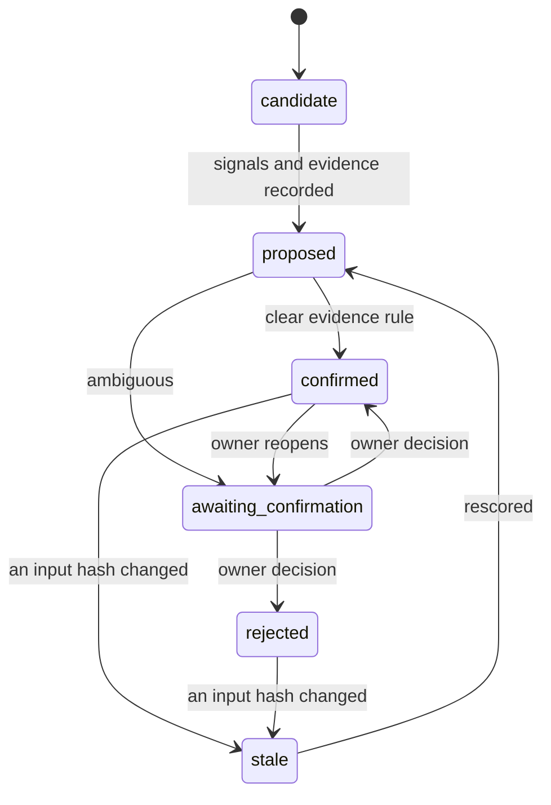
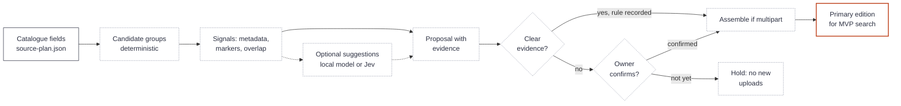

# Scripture edition and part reconciliation design

| Item | Value |
|---|---|
| Status | Proposed design. Nothing here is implemented unless section 3 marks it as actual. |
| Date | 2026-11-27 |
| Reviewed against | `main` at `7273a4b` ([ingestion and retrieval design](scripture-catalog-ingestion-and-rag-design.md), `source-plan.json` schema 2.0) |
| Owner | Pending confirmation |
| Stories | [SCR-01 catalogue](../story.md) and [SCR-02 passage search](../scripture-search/story.md) |
| Proposed location | `docs/scripture-edition-reconciliation-design.md` on `main` |

This document decides how catalogue items become works, editions, parts and witnesses, and which edition the MVP searches. It refines a Gemini proposal for a three tier deduplication pipeline (deterministic code, then Jev, then a local model and human review). That proposal is input, not a decision; section 12 records what was kept, changed or rejected.

Labels follow the ingestion design. **Actual** means evidenced by a committed file, a recorded result or the automation log. **Draft** means local or unreviewed. **Proposed** means designed but not built. **Candidate** means an option that needs evidence before it is selected. Schemas, file names and commands are **illustrative**. Catalogue and upload state is live: examples below come from the stated revision and must be recomputed, not copied as fixed counts.

## 1. Ownership and scope

| Topic | Owner |
|---|---|
| Candidate grouping, relationship classes, reconciliation statuses, automatic rules and the decision log | This document |
| Multipart assembly into one Markdown file per confirmed edition, part order, gaps and part boundary markers | This document |
| Primary edition per work for MVP search, and the role of supplementary witnesses | This document |
| Upload policy for items in unconfirmed groups and for witnesses uploaded before a decision | This document (rules); ingestion design section 11 (procedure) |
| Stage keys `edition_reconciliation` and `multipart_completeness_review` | Definitions here; status vocabulary in ingestion design section 9.5 |
| Source acquisition, conversion, fidelity, storage layout, cloud upload and readback | [Ingestion design](scripture-catalog-ingestion-and-rag-design.md) sections 5, 6, 11 |
| Identifiers, checksums and exact pointers | Ingestion design section 6; this document adds the part qualifier for passage IDs |
| Passages, indexing, retrieval, evaluation gates and cost | Ingestion design sections 12 to 14 |

## 2. Decisions

Owner decisions recorded on 2026-11-27:

1. **D1. One Markdown file per confirmed multipart edition.** It keeps the source parts in order, records gaps, and preserves the original text and its citation markers.
2. **D2. One primary edition per work for MVP search.** Other witnesses are supplementary, and their catalogue evidence is retained.
3. **D3. Safe automatic reconciliation is permitted** where the evidence clearly establishes the relationship (section 6.3). Ambiguous cases wait for owner confirmation, and their items get no new upload until then.
4. **D4. Witnesses uploaded before a decision stay as uploaded.** Upload state is read from the automation log and the review catalogue (section 9).
5. **D5. Independent eligible items keep uploading** under the ingestion design.
6. **D6. Local models, Jev and Bhashini are available options.** None is mandatory and none is prohibited.
7. **D7. Kālottara.** E00012 is the primary witness; E00011 and M00248 are supplementary.

Design decisions:

8. **R1. Matching never edits evidence.** Source files, part drafts and catalogue rows are inputs only. Every step writes new files keyed by its input hashes and recipe version.
9. **R2. Normalized text exists only for matching.** It is derived, versioned and recomputable, and it never enters the corpus, a citation or a display.
10. **R3. Rules decide only clear cases, and models never decide.** A rule confirms a relationship only when every clear evidence condition in section 6.3 holds. The decision names the rule and its version, and it stays open to owner audit and reversal. No model output confirms a merge, a duplicate or a primary edition.
11. **R4. No witness is deleted or overwritten.** A decision changes a status or a search role, never a file.

## 3. Current evidence

Facts below come from `source-plan.json` and the SCR-02 checklist at `7273a4b`, and from the owner's automation log as reported on 2026-11-27.

* **Muktabodha rows.** IDs carry `M`, `I` or `E` prefixes. Each row has `source_format: HTML` and an `archive_members` entry such as `M00002a - ahirbudhnya saMhita volume 1.htm`.
* **Fields available for matching.** `provider_item_id`, `title`, `secondary_title`, `alternate_name`, `author`, `commentator`, `editor`, `publisher`, `publication_year`, `genre`, `traditions` and `archive_members`. Coverage differs by field and is recomputed from the live catalogue.
* **Volume and part markers.** These appear in `title` as `<Volume N>` or `<Part N>`. At this revision only M00002a and M00002b carry letter suffixes in their IDs.
* **Catalogue linkage.** At this revision, `markdown_status` is still `unmatched` on most Muktabodha rows, because the catalogue is not yet linked to the local drafts.
* **Uploads.** Upload state is live. SCR-02 C-13 records verified readback of M00271 at generation `1795791085155146`, with a matching sha256. The automation log verifies M00248. Other verified uploads exist and are listed from the log, not from this document.

Example multivolume rows found by title marker (reviewer query at `7273a4b`; not a reconciled or complete list):

| Base title | Items, by marker | Observation |
|---|---|---|
| Ahirbudhnya Saṃhita | M00002a (1), M00002b (2) | same editor, publisher and year |
| Īśānaśivagurudevapaddhati | M00016 (1), M00017 (2), M00018 (3), M00233 (4) | years 1921 and 1922; volume 4 has a distant ID |
| Īśvarapratyabhijñāvivṛtivimarśinī | M00020 (1), M00021 (2), M00022 (3) | years 1941 and 1943 |
| Kriyāsāra | M00118 (1), M00050 (2) | ID order is the reverse of volume order; E00007 is a separate 2013 witness without editor |
| Prāṇatoṣiṇī | M00061 (6) | only part 6 is present |
| Āryamañjuśrīmūlakalpam | M00363 (1), M00364 (2), M00365 (3) | years 1920 and 1922 |

Three conclusions follow. Publication year can differ between volumes of one edition. ID order and suffixes are not reliable signals. Some editions are incomplete in this collection.

Title grouping also finds groups that are not volumes. Kālottara (E00011, E00012, M00248) is one example. Its secondary titles differ (`kālottarāgama` for E00011, `bṛhadkālottara` for E00012), and it has no editor or publisher in the catalogue, which is why it needed an owner decision. Step 1 regenerates group lists from the live catalogue, and no fixed list is authoritative.

## 4. Relationships, statuses and search roles

### 4.1 Relationship classes

| Class | Meaning | Typical evidence |
|---|---|---|
| `same_edition_parts` | Volumes or parts of one edition | shared base title, editor and publisher; distinct part numbers; low text overlap |
| `same_text_copy` | The same text delivered twice | identical source or Markdown body hashes, or high overlap both ways with the same edition metadata |
| `different_witness` | Another edition or a manuscript of the same work | same work; different editor, publisher, date or witness basis |
| `contains` | One text contains another, such as a root inside a commentary | high containment one way only; commentary fields |
| `distinct_works_same_title` | Different works that share a title | low overlap; different authors or genres |
| `unclear` | Not decidable on current evidence | any |

A group can hold more than one class. For example, Kriyāsāra holds `same_edition_parts` for M00118 and M00050, and a different witness, E00007.

### 4.2 Reconciliation status



These statuses map onto the stage status vocabulary of the ingestion design (section 9.5) for the `edition_reconciliation` stage:

| Reconciliation status | Stage status |
|---|---|
| `candidate`, `proposed` | `in_progress` |
| `awaiting_confirmation` | `blocked` (blocker: owner confirmation) |
| `confirmed`, `rejected` | `complete` |
| `stale` | `stale` |
| An item in no group | `not_applicable` |

### 4.3 Search role

| Role | Meaning |
|---|---|
| `primary` | The one edition per work indexed for MVP search (D2) |
| `supplementary` | Kept in the catalogue, the evidence store and, if already uploaded, the bucket; not in the MVP index |
| `hold` | In a group awaiting confirmation; no new upload; not in the MVP index unless the owner says otherwise |
| `assembled_part` | A part draft whose text is inside an assembled edition file; kept as evidence; never indexed separately |

## 5. Workflow



| Step | Executor | Inputs | Work | Outputs (all outside the corpus folder) |
|---|---|---|---|---|
| 1. Group | Code | live catalogue rows | Group rows by folded base title after removing `<Volume N>` and `<Part N>`, plus any owner supplied groups | `candidate_groups.json` |
| 2. Signals | Code | groups, part drafts, catalogue fields | Compute the signals in section 6.1 for each pair | `pair_signals.jsonl` |
| 3. Rules | Code | signals, existing decisions | Apply section 6.3: confirm clear cases, propose the rest with reasons | `proposals.jsonl`, appended to `decisions.jsonl` |
| 4. Optional suggestions | Local model, Jev or Bhashini | pairs left `unclear` or in disagreement, plus reviewed examples | Add suggestions as unverified evidence (section 6.4) | `suggestions.jsonl` |
| 5. Owner decision | Owner | ambiguous proposals, evidence, suggestions | Confirm, reject or defer, and choose the primary edition where needed | appended to `decisions.jsonl` |
| 6. Assembly | Code | confirmed `same_edition_parts` decisions | Build one edition file and verify it (section 7) | edition Markdown, `assembly/<edition_id>.json` |

Rules for every step:

* **Inputs are never modified.** Outputs go to new files.
* **Outputs are deterministic.** Each output names its input hashes, `catalog_release` and `recipe_version`, and a rerun with identical inputs writes identical bytes.
* **IDs are stable.** A pair ID is `pair-` plus the first 16 hex of sha256 over the sorted catalogue item IDs. A group ID uses the same rule over its members. A changed membership mints a new group ID that records `supersedes`.
* **Decisions are append only.** A changed decision is a new record with `supersedes`. A rule never supersedes an owner decision.

The Kālottara record below reflects D7. The owner chose roles but stated no relationship class, so `relationship` stays null. Fields marked with angle brackets are placeholders.

```json
{
  "decision_id": "dec-kalottara-0001",
  "subject": {"type": "group", "id": "grp-<hash>"},
  "members": ["muktabodha-e00011", "muktabodha-e00012", "muktabodha-m00248"],
  "relationship": null,
  "roles": {
    "muktabodha-e00012": "primary",
    "muktabodha-e00011": "supplementary",
    "muktabodha-m00248": "supplementary"
  },
  "decided_by": "owner",
  "decided_on": "2026-11-27",
  "evidence": ["catalogue: title, secondary_title, publication_year"],
  "inputs": {"catalog_release": "<tag>", "recipe_version": null},
  "status": "confirmed",
  "supersedes": null
}
```

A rule decision has the same shape, with `decided_by` set to the rule and version, such as `rule:same_edition_parts_clear@1`.

## 6. Signals, rules and models

### 6.1 Deterministic signals

* **Catalogue fields.** Base title, marker type and number, `editor`, `publisher`, `publication_year`, `author`, `commentator`, `secondary_title`, `alternate_name` and `archive_members`.
* **File facts.** Source and Markdown sha256, byte size, and counts of page markers and of the lacuna pattern. The lacuna pattern, `....` in the proposal, must be confirmed on the actual drafts first.
* **Overlap.** Jaccard similarity and containment in each direction over character 5 grams of the matching text (section 6.2). Containment separates `contains` from `same_text_copy`.
* **Header IDs.** Source header IDs found in the files, compared with the catalogue ID. Known header exceptions are listed in the ingestion design section 2.

The proposal parses a `####` header block in `.txt` files. The Muktabodha sources here are HTML archive members converted to Markdown, so header parsing must be confirmed on real files. Catalogue fields come first.

### 6.2 Matching text

The matching text is derived from the Markdown by a recipe with a version number, such as `match-recipe@1`. The recipe applies Unicode NFC, lowercases, removes Markdown syntax and the page markers named in the recipe, and collapses whitespace. It removes bracket characters but keeps the text inside them, because editorial brackets can hold readings. The proposal drops bracketed text entirely, which would discard content.

Matching text is never stored in the corpus. It may be cached outside the corpus under its input hash and recipe version, and it can always be recomputed from the unchanged source. That is what makes normalization reversible in effect. Transliteration between scripts for matching is a candidate.

### 6.3 Rules

The proposal's fast path classifies a pair as sequential volumes and keeps all when 5 gram Jaccard is below 0.10 and a sequential marker exists. That rule is not adopted as written:

* Low overlap is also typical of distinct works that share a title and of a root against a much longer commentary, so it is not sufficient.
* Markers alone do not prove one edition. Two editions can each have volumes, and ID suffixes are rare.
* The 0.10 threshold has no evidence behind it on this corpus.

**Clear case, `same_edition_parts`: confirmed automatically by `rule:same_edition_parts_clear@1` when every condition holds.**

1. The base titles match after the provider marker is removed.
2. Part numbers parse, are distinct, and have no duplicates within the group.
3. `editor` and `publisher` are present and identical across members. `publication_year` may differ.
4. Containment is below the review stop in both directions. The stop is a placeholder (0.10) until it is tuned on reviewed pairs, and anything at or above it goes to the owner.
5. Each member's source header ID matches its catalogue ID, and no member is a known header exception.
6. No member has a different witness date, a different editor, or an owner decision that conflicts.

Missing numbers become gaps and do not block a clear case. For example, Prāṇatoṣiṇī has only part 6.

**Clear case, `same_text_copy`: confirmed automatically by `rule:same_text_copy_clear@1`** when source file sha256 or Markdown body sha256 are identical. The member already uploaded, or else the lowest ID, becomes `primary`, unless the owner has chosen otherwise.

**Clear case, single edition.** A work with exactly one edition after reconciliation makes that edition `primary`.

**Everything else is ambiguous** and goes to `awaiting_confirmation`. That includes conditions 1 and 2 holding while any other condition fails, missing editor or publisher, any `contains`, `different_witness` or `distinct_works_same_title` proposal, and any group with several editions. Kālottara is an example.

Before a rule runs unattended, it is checked against the reviewed pairs in section 10. Every automatic decision is listed for owner audit, and the owner can reopen it.

### 6.4 Optional models

Models add suggestions only, for pairs that the rules leave `unclear` or where signals disagree, plus reviewed examples for evaluation. Their outputs are stored as unverified evidence with model ID, request ID and recipe version, and they never confirm anything.

* **Jev** (`jev-1.14.0`). The [models page](https://docs.typesafe.ai/models) lists text input, the Choice, Score, Noul and Box types, and input token pricing. The [introduction](https://docs.typesafe.ai/introduction) says all questions in one request are evaluated in parallel against the same state. The [confidence page](https://docs.typesafe.ai/confidence) defines confidence as the concentration of the probability distribution, makes no calibration claim, returns no confidence for Noul, and says thresholds depend on the domain and must be tested on your own data. The proposal's "calibrated confidence" and its fixed 0.90 auto accept are therefore not adopted. Confidence may order the review queue. Any threshold is set from reviewed pairs and recorded with the model version.
* **Jev question set (illustrative).** `relationship` as a Choice over the classes in section 4.1. `printed_edition_a` and `printed_edition_b` as Noul. The proposal's `preferred_action` choice of `keep_file_a` or `keep_file_b` is rejected, because no witness is dropped (R4).
* **Integration.** The proposal's `POST /v1/systemone` endpoint and `typesafe_sdk` package are not confirmed in TypeSafe's documentation. The confidence page shows a Python `client.system_one(...)` call. LiteLLM [removed its TypeSafe pass through](https://docs.litellm.ai/docs/pass_through/typesafe) in `v1.113.0` and names `/v1/systemone` and `/v1/decisions` as replacements. A [LangChain integration](https://docs.langchain.com/oss/python/integrations/providers/typesafe) exists as `langchain-typesafe>=0.1.0`. Confirm the client before building.
* **Local model.** The proposal's [`qwen3-coder-next`](https://ollama.com/library/qwen3-coder-next) is listed by Ollama as a coding focused model (52 GB at `latest`). Its value for Sanskrit textual comparison is unknown. A local summary helps the reviewer read a pair. It is not evidence and is never quoted as a finding.
* **Bhashini.** Available for transliteration or translation experiments. Its Sanskrit coverage is not assessed here.
* **Source terms.** Before any hosted call, the owner checks the recorded source terms by hand (ingestion design, MVP simplification).

## 7. Multipart assembly

### 7.1 Rules

1. Assemble only `same_edition_parts` groups with a `confirmed` decision, whether by a clear evidence rule or by the owner.
2. Order the parts by part number, not by ID. For example, Kriyāsāra runs M00118 then M00050.
3. Use each part's Markdown after its fidelity review. The bytes of each part body are copied unchanged, including page markers, verse numbers and citation markers.
4. Write a boundary marker before and after each part, and one gap marker for each missing part. Markers are HTML comments, so they do not change the rendered text.
5. Give the assembled file its own edition ID and its own `markdown_sha256` (ingestion design section 6). Part drafts keep their catalogue item IDs and hashes and take the role `assembled_part`.
6. Keep each part's own front matter in the part draft, and record its hash in the edition front matter.

### 7.2 File layout (illustrative)

```markdown
---
edition_id: muktabodha-ahirbudhnya-samhita-adyar-1916
work_id: null
assembly_manifest: SPIRITUALITY_WORKSPACE:scripture-ingestion/pilot/reconciliation/assembly/muktabodha-ahirbudhnya-samhita-adyar-1916.json
parts:
  - sequence: 1
    catalog_item_id: muktabodha-m00002a
    marker: "<Volume 1>"
    body_sha256: "<hash>"
  - sequence: 2
    catalog_item_id: muktabodha-m00002b
    marker: "<Volume 2>"
    body_sha256: "<hash>"
gaps: []
---

<!-- part 1 begin: muktabodha-m00002a -->
(part 1 body, byte for byte)
<!-- part 1 end: muktabodha-m00002a -->

<!-- part 2 begin: muktabodha-m00002b -->
(part 2 body, byte for byte)
<!-- part 2 end: muktabodha-m00002b -->
```

A missing part is written as `<!-- gap: part 3, status unavailable, evidence <pointer> -->` in its sequence position.

### 7.3 Assembly manifest (illustrative)

```json
{
  "edition_id": "muktabodha-ahirbudhnya-samhita-adyar-1916",
  "decision_id": "dec-<id>",
  "edition_evidence": {
    "editor": "Pandit M. D. Ramanujacarya",
    "publisher": "The Adyar Library and Research Center",
    "publication_year": "1916"
  },
  "parts": [
    {"sequence": 1, "catalog_item_id": "muktabodha-m00002a", "archive_member": "M00002a - ahirbudhnya saMhita volume 1.htm", "part_markdown_sha256": "<hash>", "body_byte_start": 0, "body_byte_end": 0},
    {"sequence": 2, "catalog_item_id": "muktabodha-m00002b", "archive_member": "M00002b - ahirbudhnya saMhita volume 2.htm", "part_markdown_sha256": "<hash>", "body_byte_start": 0, "body_byte_end": 0}
  ],
  "gaps": [],
  "expected_parts": "unknown",
  "assembled_markdown_sha256": "<hash>",
  "recipe_version": "assembly@1",
  "status": "proposed"
}
```

Editor, publisher, year and archive members are copied from the catalogue. The hashes and byte offsets are placeholders.

### 7.4 Verification

* For each part, the bytes between its markers equal the part body, and their sha256 equals `body_sha256`.
* Part numbers are strictly increasing, and every gap lies in sequence.
* A rerun from the same inputs reproduces `assembled_markdown_sha256` exactly.
* `multipart_completeness_review` records gaps. It may be `complete` while the edition is incomplete (ingestion design section 7.6).

### 7.5 Locators and citations

Numbering often restarts in each volume, so a passage ID in an assembled edition carries the part: `<edition_id>:p<sequence>:<scheme><native locator>`, for example `muktabodha-ahirbudhnya-samhita-adyar-1916:p2:page0045`. A citation shows the edition, the part marker as the source gives it, and the native locator. Byte offsets refer to the assembled file, and the manifest maps them back to the part.

## 8. Primary edition for MVP search

* Each work has one `primary` edition. It is set by the clear cases in section 6.3 or by the owner. When signals are used to rank candidates for the owner, they are recorded signals only: fidelity review status, coverage and gaps, lacuna counts, and presence of edition metadata.
* All other members take `supplementary`. Their catalogue rows, evidence, local files and any existing cloud objects stay unchanged.
* A commentary edition is a separate work for this purpose (`commentary_on`), so a work and its commentary can each have a primary edition.
* A primary edition that is assembled is uploaded and indexed as one file. Its parts are not indexed separately.
* Kālottara: E00012 is primary; E00011 and M00248 are supplementary (D7).

## 9. Uploads and previously uploaded witnesses

* Items with role `hold` get no new upload until their group is `confirmed` or `rejected` (D3).
* Items in no group, and items in confirmed groups, continue through ingestion design section 11.4 (D5).
* An assembled edition is a new object named from its edition ID and uploaded with `--if-generation-match=0`, so nothing is overwritten.
* Witnesses uploaded before a decision stay in place (D4). Their objects are never deleted or overwritten, and after the decision their role changes only in the catalogue and the index.
* The upload register is generated from the automation log and the review catalogue at reconciliation time. The rows below are examples, not the live list.

| Catalogue item | Upload evidence | Group | Role | Status |
|---|---|---|---|---|
| `muktabodha-m00271` | SCR-02 C-13: generation `1795791085155146`, sha256 matched | Vijñāna Bhairava witnesses | not yet decided | `proposed` |
| `muktabodha-m00248` | automation log (verified upload) | Kālottara | `supplementary` | `confirmed` (owner) |

## 10. Evaluation (proposed; nothing measured)

Tests M1 to M4 in the [technology evaluation plan](scripture-technology-evaluation-plan.md#4-catalogue-and-reconciliation-evaluations) state what is tested, the success criterion and the decision that follows.

* **Reviewed pairs.** The owner labels a set of pairs with the classes in section 4.1. Proposed size: every pair in the multivolume groups that step 1 finds, plus at least 40 other pairs from title groups, frozen before any threshold is set.
* **Metrics.** For each rule and each optional model, report precision and recall per class, the share left `unclear`, and the disagreement rate with the owner.
* **Automatic rules.** A clear evidence rule runs unattended only after it makes no wrong confirmation on the reviewed pairs. Its stop thresholds are tuned there and recorded with the recipe version.
* **Thresholds.** Any model confidence used to order the queue is chosen on these pairs and recorded with the model version. Thresholds are never assumed.

## 11. Cost

Code steps have no model cost. For optional Jev calls, cost ≈ pairs × input tokens per pair × the input price, with output free per the models page as checked on 2026-11-26 ($0.042 per million input tokens). For example, 100 pairs at 3,000 tokens each come to 0.3 million tokens, about one cent. Owner review time dominates.

## 12. Assessment of the Gemini proposal

| Proposal element | Finding | Decision |
|---|---|---|
| Deterministic first, model second, human last | Consistent with ingestion design decisions 1 and 2 | Kept |
| Parse `####` header blocks in `.txt` files | Sources here are HTML archive members converted to Markdown | Catalogue fields first; header parsing confirmed on real files |
| Strip brackets and their contents, digits and verse numbers | Removes readings and locators | Recipe keeps bracket contents; matching text is derived only (section 6.2) |
| Jaccard below 0.10 plus a sequential marker means keep all | Not sufficient; threshold unsupported | Replaced by the clear case rule in section 6.3; ambiguous cases wait for the owner |
| `M00002a`/`b` suffix as a marker | Suffixes are rare; `<Volume N>` and `<Part N>` in titles are the real markers | Title markers used |
| Jev returns calibrated confidence; auto accept at 0.90 | Confidence measures concentration; no calibration claim; thresholds are domain specific | No model auto accept; thresholds set from reviewed pairs |
| `preferred_action` keep A or keep B | Would drop witnesses | Rejected; primary and supplementary are roles (section 8) |
| `POST /v1/systemone`, `typesafe_sdk`, LiteLLM pass through | Not confirmed in TypeSafe docs; LiteLLM removed the pass through | Confirm the client before building |
| Ollama `qwen3-coder-next` prose summaries | Coding focused model; Sanskrit ability unknown | Optional reviewer aid, not evidence |
| "Do NOT use Bhashini" | Conflicts with D6 | Bhashini is an option |
| Output `confirmed_catalog.json` | A second catalogue would diverge | Append only `decisions.jsonl`; catalogue updated through the ingestion design migration |
| A fixed list of 29 candidate groups | Not in the repository; counts are live | Step 1 regenerates groups; an owner list may seed it |

## 13. Open decisions

1. Whether `hold` items are excluded from the MVP index.
2. Whether the proposal's candidate group list should seed step 1.
3. Whether two items with empty `editor` and `publisher` can ever be a clear case, and on what evidence.
4. Edition ID slugs for assembled editions.
5. Whether `expected_parts` can be sourced from publisher bibliographies.

## 14. References

* Repository at `7273a4b`: [ingestion and retrieval design](scripture-catalog-ingestion-and-rag-design.md), [catalogue register](../source-plan.json), [inventory review](../inventory-review.md), [SCR-01 story](../story.md), [SCR-02 story](../scripture-search/story.md), [SCR-02 checklist](../scripture-search/checklist.json)
* Sources: [Muktabodha Digital Library](https://muktabodha-digital-library.org/), [GRETIL](https://gretil.sub.uni-goettingen.de/gretil.html)
* Jev: [models](https://docs.typesafe.ai/models), [introduction](https://docs.typesafe.ai/introduction), [confidence](https://docs.typesafe.ai/confidence)
* Integrations: [LangChain TypeSafe](https://docs.langchain.com/oss/python/integrations/providers/typesafe), [LiteLLM pass through notice](https://docs.litellm.ai/docs/pass_through/typesafe)
* Local model: [Ollama `qwen3-coder-next`](https://ollama.com/library/qwen3-coder-next)
* Diagrams: [GitHub Mermaid support](https://docs.github.com/en/get-started/writing-on-github/working-with-advanced-formatting/creating-diagrams)
